<div align="center">

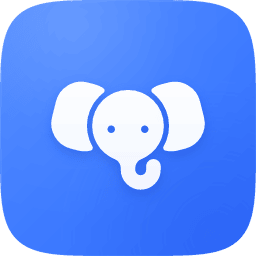

# norsumi

**Every screenshot, remembered.**

norsumi catches every screenshot you take and everything you share to it, then AI names, summarizes and files it into a library you can search by meaning. On Android and on the web.

[](#get-started)
[](apps/android)
[](apps/web)
[](apps/api)
[](#privacy--security)
[](LICENSE)

**[Website](https://norsumi.com)** &nbsp;·&nbsp; **[Download for Android](https://github.com/christiancuri/norsumi/releases/latest)** &nbsp;·&nbsp; **[Open the web app](https://norsumi.com/library)**

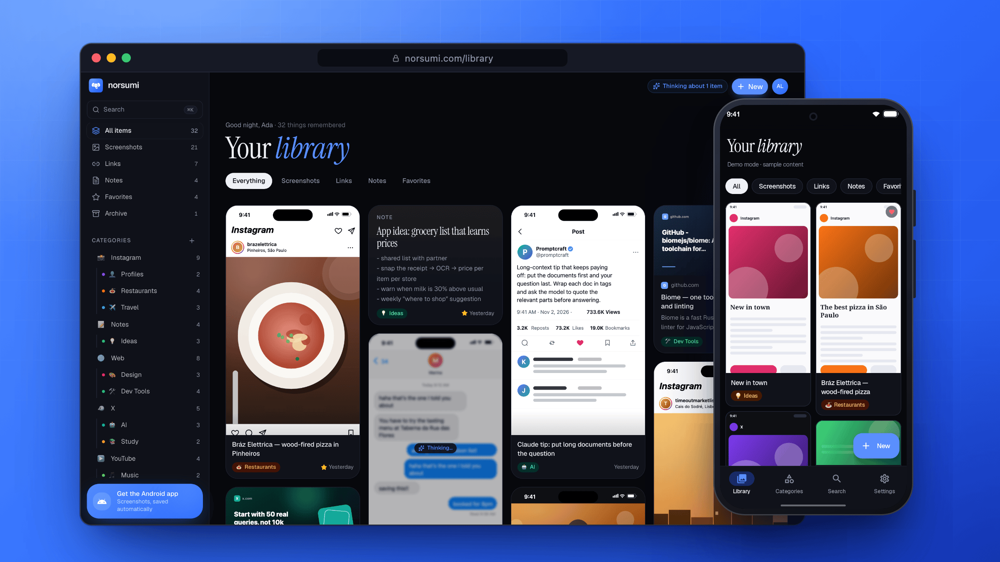

</div>

## Why

We screenshot things to remember them: a restaurant on Instagram, a tip on X, a recipe, a talk, an address. Then they sink into a camera roll of thousands of images and we never find them again. norsumi reads each one the moment you take it, so you can find it later by what it meant, not by when you saved it.

## Get started

The fastest way is the hosted cloud at **[norsumi.com](https://norsumi.com)**: nothing to install or run, and your library is the same on every device.

1. **[Download the Android app](https://github.com/christiancuri/norsumi/releases/latest)** (the `.apk` from the latest release) and open it.
2. Sign in with **Google** or with an **email and password**.
3. Allow what it asks for, then take a screenshot. It shows up in your library a few seconds later, already named and filed.

**Requirements:** Android 10 or later. The web app works in any modern browser, on desktop or phone.

**Permissions, and why:**

- **Photos access** lets the app notice new screenshots. Only files in your Screenshots folder are ever uploaded, never the rest of your photos. Turning auto-capture on starts from that moment; nothing from your history is uploaded unless you import it.
- **Notifications** (optional) show upload progress and the Instant capture indicator.
- **Battery exemption** (optional) keeps background uploads on time on phones that delay background work, Samsung especially.

## Features

- **Auto-capture.** Every new screenshot is detected and uploaded in the background, even when the app is closed. Turn on Instant capture to have it within a second, or import your last 20 screenshots in one tap.
- **Share from any app.** Send a link, some text or up to 20 images to norsumi from the share sheet. A link becomes a link card, plain text becomes a note, and it works offline: shares wait for a network.
- **An AI library that files itself.** Each item gets a title, a summary, tags and its source, and lands in a two-level library by source and topic: _Instagram › Restaurants_, _X › AI_, _Web › Programming_. The AI reuses your existing categories instead of inventing near-duplicates.
- **Entities that act.** Places, accounts, products, books, events, prices and links are pulled out of each screenshot as chips. A place opens in Google Maps, an account opens its profile, a link opens the site.
- **Search by meaning.** Hybrid search mixes keywords with semantic embeddings, so "that pizza place in São Paulo" finds the screenshot even if it never says "pizza place". Press <kbd>⌘</kbd> <kbd>K</kbd> on the web.
- **Text in the image.** The text in every screenshot is extracted and searchable, with one-click copy.
- **Edit everything.** Rename, re-summarize, retag or move any item, rename, re-emoji and recolor categories, add your own note, favorite, archive, or ask the AI to redo it. Your edits always win over later AI runs.
- **Web app, desktop and mobile.** A masonry library with an item viewer, ⌘K search and keyboard shortcuts. Drop an image anywhere, or paste an image or a URL, to add it.
- **Light and dark**, on Android and on the web, or following the system.
- **Encrypted storage.** Every file is encrypted with a key that is unique to you before it reaches object storage.
- **Open source** under AGPL-3.0: the API, the web app and the Android app are all in this repository.

## Screenshots

<table>
  <tr>
    <td width="50%">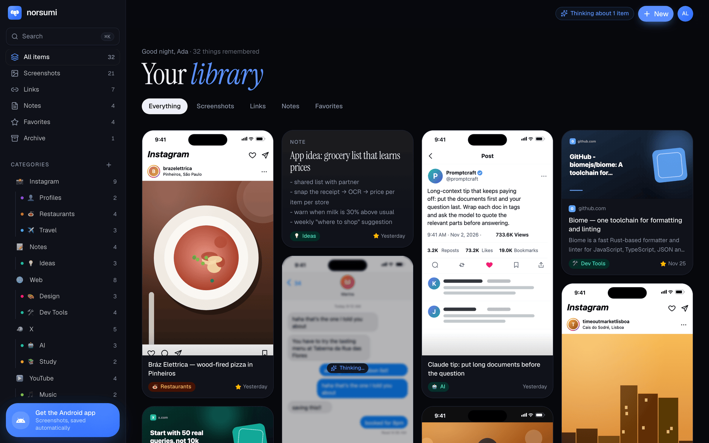</td>
    <td width="50%">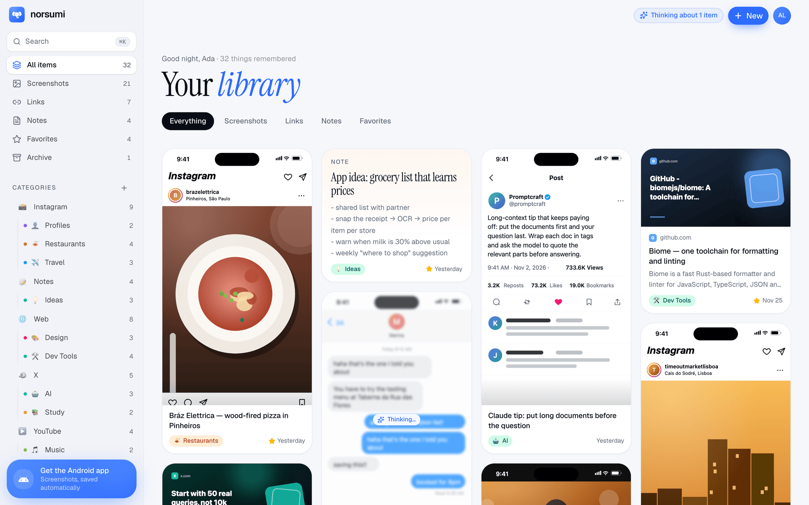</td>
  </tr>
  <tr>
    <td align="center"><sub>The library on the web (dark)</sub></td>
    <td align="center"><sub>The same library in light mode</sub></td>
  </tr>
  <tr>
    <td>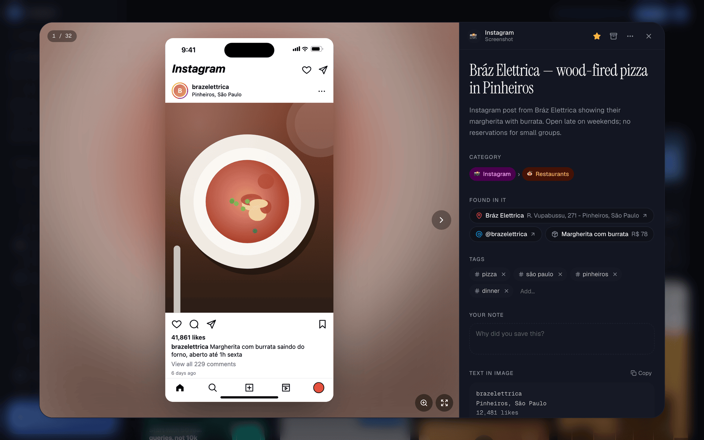</td>
    <td>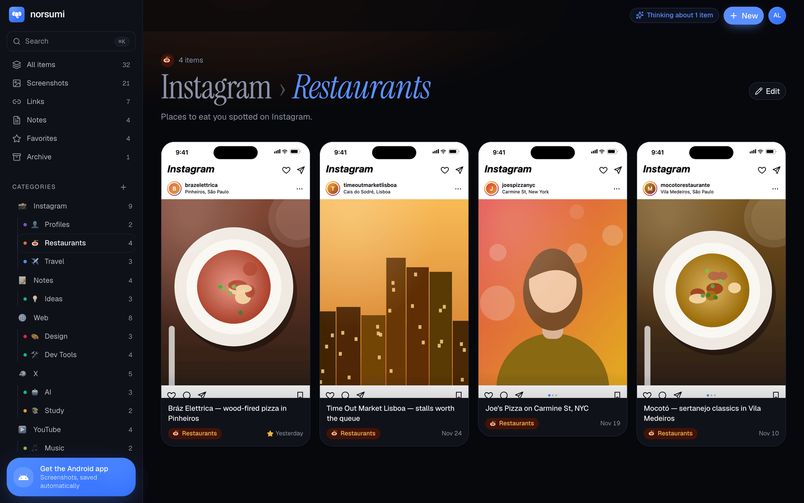</td>
  </tr>
  <tr>
    <td align="center"><sub>Every item, read: summary, category, entities and text</sub></td>
    <td align="center"><sub>Two levels: source › topic</sub></td>
  </tr>
  <tr>
    <td>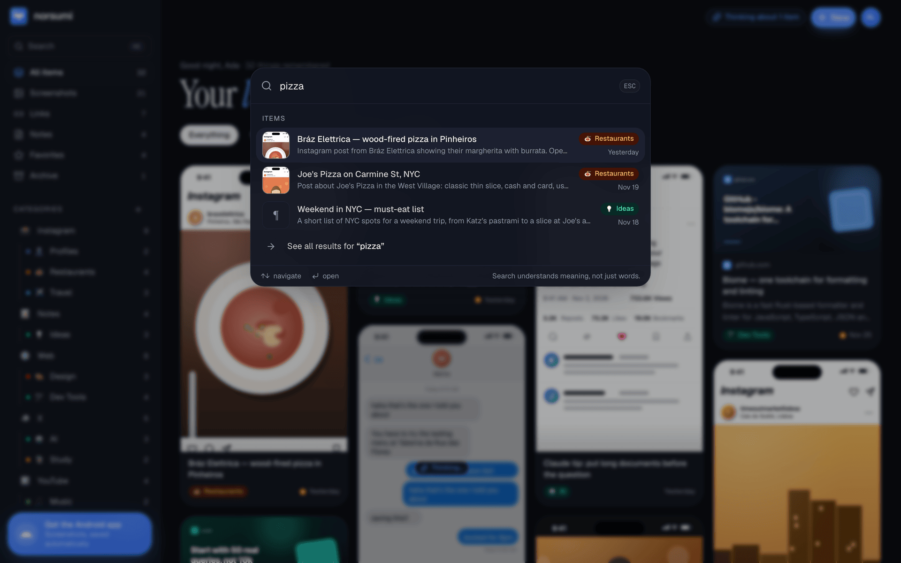</td>
    <td>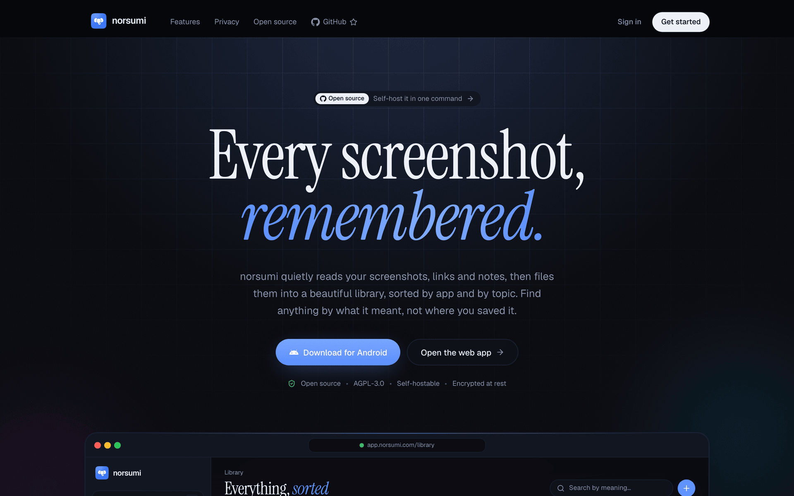</td>
  </tr>
  <tr>
    <td align="center"><sub>⌘K search across titles, text and meaning</sub></td>
    <td align="center"><sub>norsumi.com</sub></td>
  </tr>
</table>

<table>
  <tr>
    <td width="33%">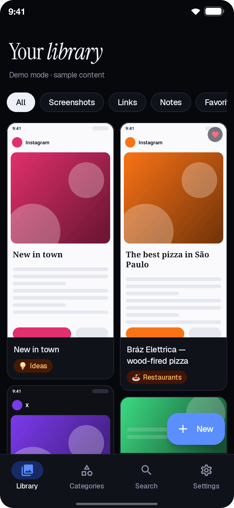</td>
    <td width="33%">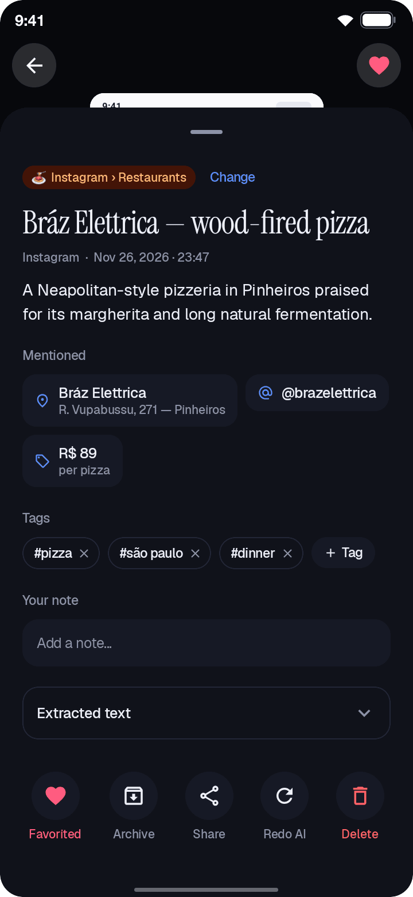</td>
    <td width="33%">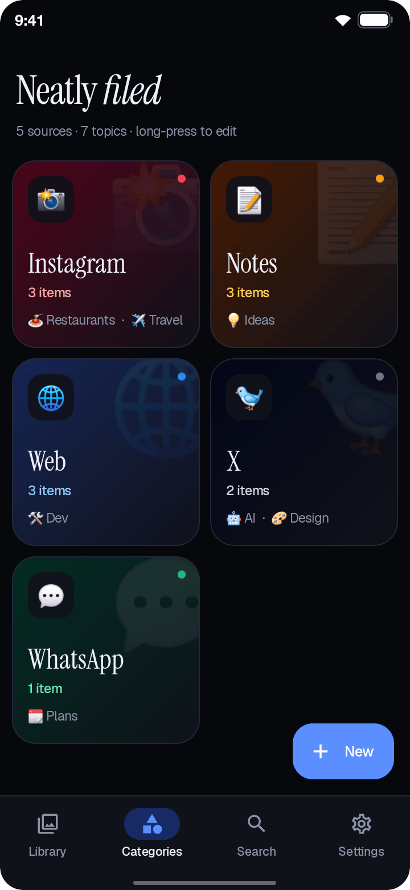</td>
  </tr>
  <tr>
    <td align="center"><sub>Library</sub></td>
    <td align="center"><sub>Item detail</sub></td>
    <td align="center"><sub>Categories</sub></td>
  </tr>
  <tr>
    <td>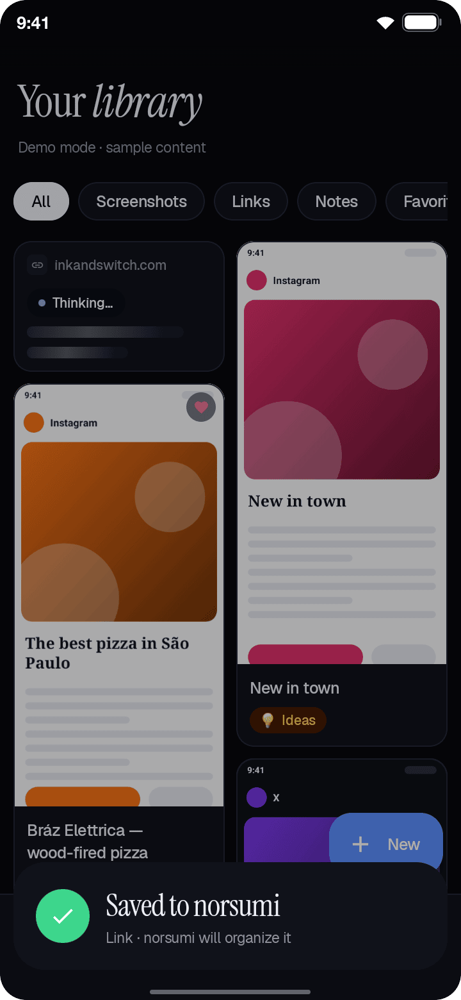</td>
    <td>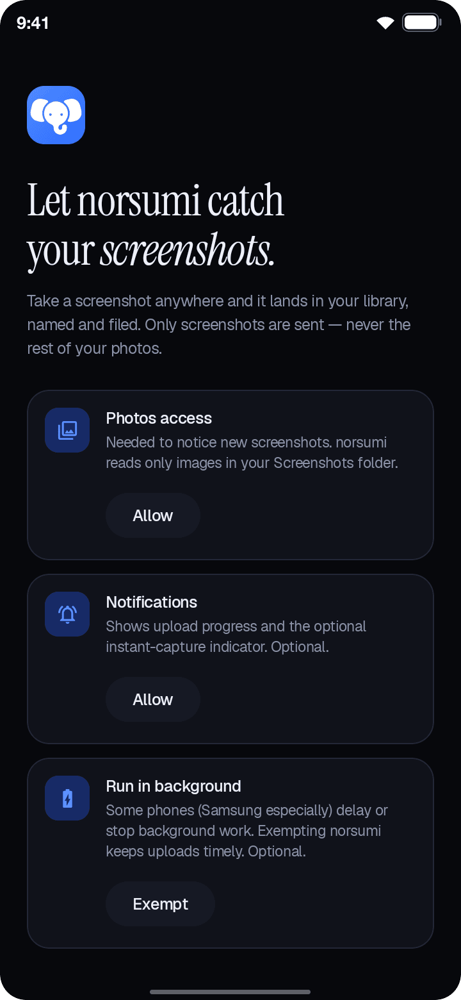</td>
    <td>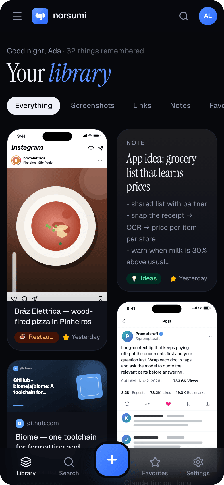</td>
  </tr>
  <tr>
    <td align="center"><sub>Shared from another app</sub></td>
    <td align="center"><sub>Auto-capture setup</sub></td>
    <td align="center"><sub>The web app on a phone</sub></td>
  </tr>
</table>

## How it works

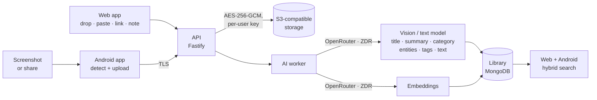

1. **Capture.** The Android app watches MediaStore for new files in your Screenshots folder (a WorkManager content trigger, or an optional foreground observer) and uploads each one once. Shares, drops and pastes go through the same API.
2. **Store.** The API checks the file, removes duplicates, makes a thumbnail, and encrypts every blob with your data key before it is written to object storage. The item comes back right away as _pending_.
3. **Understand.** A background worker sends the image (or the link's page text, or the note) to the AI with your current category tree and a strict JSON schema. It gets back the title, summary, source, category path, tags, entities and the text in the image.
4. **Index.** Title, summary, tags and text are embedded for semantic search, and the item is marked _ready_. Your apps pick it up on their next refresh.
5. **Find.** Search ranks results by keyword match plus embedding similarity, so you can search for what you remember, not the exact words.

## Privacy & security

- **In transit:** HTTPS everywhere. Release builds of the Android app refuse plain HTTP.
- **At rest:** every file is encrypted with **AES-256-GCM** using a **data key unique to you**, which is itself wrapped by a server master key. The bucket only ever holds ciphertext.
- **AI:** all model calls go through [OpenRouter](https://openrouter.ai) with **Zero Data Retention enforced** (`provider.zdr`) and **data collection denied**, so providers do not keep or train on your screenshots.
- **Accounts:** passwords are hashed with **argon2id**, a per-hash salt and a server-side pepper. Sign-in tokens on Android are encrypted with a key in the Android Keystore. Deleting your account deletes every item, file and category.
- **No ads, no tracking, no selling your data.**
- **To be clear:** this is server-side encryption, **not end-to-end**. The server has to decrypt an image to show it to you and to let the AI read it. If you need the keys to be yours alone, run it yourself (see [Self-hosting](#self-hosting)).

## AI models

Bring your own: every model is an [OpenRouter](https://openrouter.ai/models) model id set
by environment variable, so you can pick what fits your quality and budget.

| Variable                                         | Used for               | Needs                                           |
| ------------------------------------------------ | ---------------------- | ----------------------------------------------- |
| `AI_VISION_MODEL` (+ `AI_VISION_FALLBACK_MODEL`) | Screenshots and images | Image input, structured outputs, a ZDR endpoint |
| `AI_TEXT_MODEL` (+ `AI_TEXT_FALLBACK_MODEL`)     | Links and notes        | Structured outputs, a ZDR endpoint              |
| `AI_EMBEDDING_MODEL`                             | Search by meaning      | An embeddings model with a ZDR endpoint         |

Each item is one structured-output call: the primary model first, then the optional fallback
once if the primary fails.

## Tech stack

| App                                  | Stack                                                                                                                         |
| ------------------------------------ | ----------------------------------------------------------------------------------------------------------------------------- |
| [`apps/android`](apps/android)       | Kotlin, Jetpack Compose (Material 3), Navigation Compose, WorkManager, OkHttp, Coil, Credential Manager (Sign in with Google) |
| [`apps/web`](apps/web)               | Vite, React 19, TypeScript, Tailwind CSS 4, shadcn/ui, react-query-kit, zustand, motion                                       |
| [`apps/api`](apps/api)               | Node 26, Fastify 5, typegoose (MongoDB), S3 client, sharp, argon2, Zod, pino, Vitest                                          |
| [`packages/common`](packages/common) | API contract types shared by every client                                                                                     |

## Repository layout

```
apps/
  android/          native Android app (standalone Gradle project)
  api/              Fastify API, AI worker, envelope encryption
  web/              landing page and web app
packages/common/    shared API contract types
brand/              logo, icons, wordmark and the scripts that generate them
deploy/             production compose, Caddy, deploy script, self-hosting notes
docs/               api.md (contract), design.md (design language), images
```

## Development

Requirements: Node 26 (`.nvmrc`), pnpm 10, and for Android, JDK 17 and the Android SDK.

```bash
pnpm install
cp apps/api/.env.example apps/api/.env   # fill it in: MongoDB, S3, OpenRouter, secrets
pnpm dev                                 # API on :3000 + web on :8080 (proxies /api)

VITE_MOCK=1 pnpm -F @norsumi/web dev     # web only, with an in-memory fake backend
```

```bash
cd apps/android
./gradlew :app:assembleDebug             # debug builds talk to http://localhost:3000
adb reverse tcp:3000 tcp:3000
```

Checks: `pnpm lint`, `pnpm type-check`, `pnpm test`, `pnpm build`. Debug Android builds have a demo mode with sample content (long-press the logo on the welcome screen), so you can work on the UI without an API. More in [`CLAUDE.md`](CLAUDE.md), [`docs/api.md`](docs/api.md), [`docs/design.md`](docs/design.md) and each app's README.

## Self-hosting

norsumi is open source, so you can run your own instance, but there is no turnkey bundle: if you self-host, you own the setup, the backups and the master key. You need **Node 26** (or the Dockerfiles), **MongoDB 8+**, **S3-compatible object storage**, an **OpenRouter API key** and an **HTTPS reverse proxy**; Google sign-in is optional. The steps are in [deploy/README.md](deploy/README.md#self-hosting). For almost everyone, **[norsumi.com](https://norsumi.com)** is the better choice.

## Contributing

Issues and pull requests are welcome. Please open an issue before a large change. Commits follow [Conventional Commits](https://www.conventionalcommits.org) (`feat:`, `fix:`, `docs:` …); husky runs Biome and commitlint before each commit. If you change the API, update [`docs/api.md`](docs/api.md) and `packages/common` together, then every client that uses it.

## License

[AGPL-3.0](LICENSE). If you run a modified norsumi as a service, you must publish your changes under the same license.

<div align="center">
<sub>Made with ♥ in Brazil</sub>
</div>
